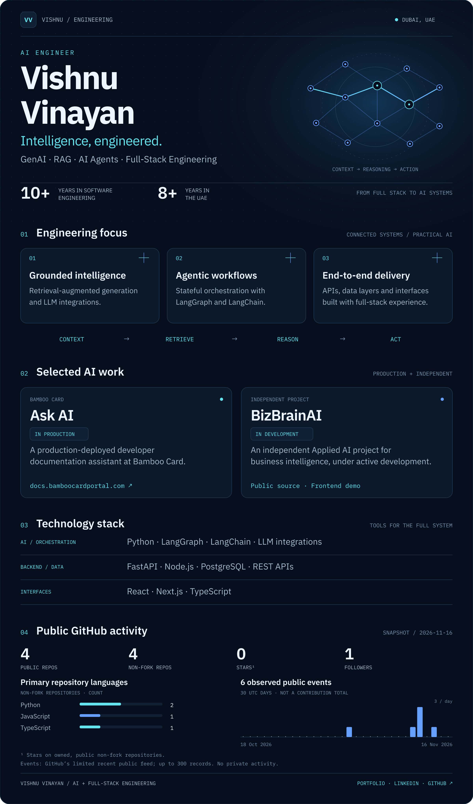
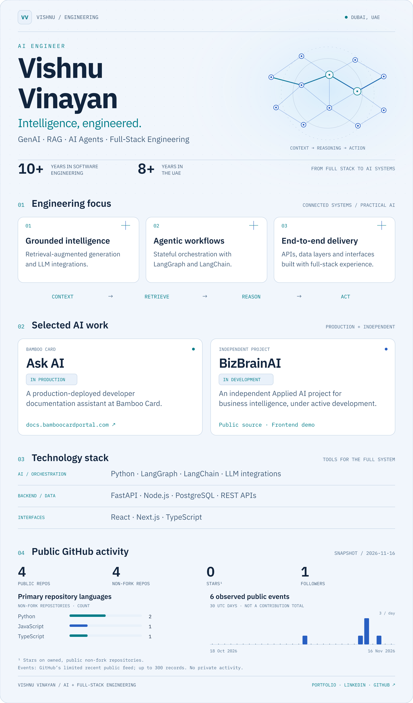

<a href="./assets/profile-dark-desktop.png#gh-dark-mode-only">
<picture>
  <source media="(max-width: 900px)" srcset="./assets/profile-dark-mobile.png" />
  
</picture>
</a>

<a href="./assets/profile-light-desktop.png#gh-light-mode-only">
<picture>
  <source media="(max-width: 900px)" srcset="./assets/profile-light-mobile.png" />
  
</picture>
</a>

**Vishnu Vinayan — AI Engineer | GenAI, RAG & AI Agents | Full-Stack Engineering**

10+ years of software engineering experience, including 8+ years in the UAE.

[Portfolio](https://www.vishnuvinayan.com/) · [LinkedIn](https://www.linkedin.com/in/vishnuvinayan/) · [GitHub](https://github.com/therealvishnuvinayan) · [Ask AI ↗](https://docs.bamboocardportal.com/)

Read the profile, projects & public statistics as text

## AI engineering focus

- **Grounded intelligence:** retrieval-augmented generation and LLM integrations.
- **Agentic workflows:** stateful orchestration with LangGraph and LangChain.
- **End-to-end delivery:** APIs, data layers and interfaces built with full-stack experience.

## Selected work

**[Ask AI — Bamboo Card](https://docs.bamboocardportal.com/)**  
A production-deployed developer documentation assistant at Bamboo Card. Use the **Ask AI** entry point on the public documentation site.

**[BizBrainAI — Independent Applied AI project](https://github.com/therealvishnuvinayan/BizBrainAI)**  
A public, independent Applied AI project under active development, exploring business questions with inspectable evidence. The [Next.js frontend demo](https://bizbrainai.vercel.app) uses synthetic local data and prepared investigations. A separate FastAPI/PostgreSQL backend implements bounded tool calling with LangGraph and is verified offline. The demo does not call the backend; backend deployment and a live end-to-end AI answer are not verified.

**[Video Sentiment Model](https://github.com/therealvishnuvinayan/video-sentiment-model)**  
An experimental multimodal ML project exploring emotion and sentiment classification from text, video and audio. It includes measured text-only baselines and synthetic pipeline verification. Real-media multimodal training and accuracy remain unvalidated.

## Technology stack

- **AI and orchestration:** Python, LangGraph, LangChain, LLM integrations.
- **Backend and data:** FastAPI, Node.js, PostgreSQL, REST APIs.
- **Interfaces:** React, Next.js, TypeScript.

## Public GitHub snapshot

Collected **2026-11-16T19:10:41.524Z** from GitHub's unauthenticated public REST API.

| Metric | Value | Scope |
| :--- | ---: | :--- |
| Public repositories | 4 | Owned by this account; includes forks |
| Non-fork repositories | 4 | Owned public repositories, excluding forks |
| Repository stars | 0 | Sum across owned public non-fork repositories |
| Followers | 1 | Public account count |
| Observed public events | 6 | 2026-10-18 through 2026-11-16, UTC; limited recent feed |

Primary language per owned public non-fork repository:

| Language | Repositories |
| :--- | ---: |
| Python | 2 |
| JavaScript | 1 |
| TypeScript | 1 |

Observed event types (an event is **not** a commit or a contribution):

| Event type | Observed events |
| :--- | ---: |
| PublicEvent | 2 |
| PushEvent | 2 |
| WatchEvent | 2 |

[Daily chart values](./data/activity.csv) · [Public-data snapshot](./data/github-public.json) · [Sources & methodology](./docs/METHODOLOGY.md)

Original generated artwork · Public data only · Snapshot 2026-11-16 · <a href="./docs/METHODOLOGY.md">Methodology</a>
